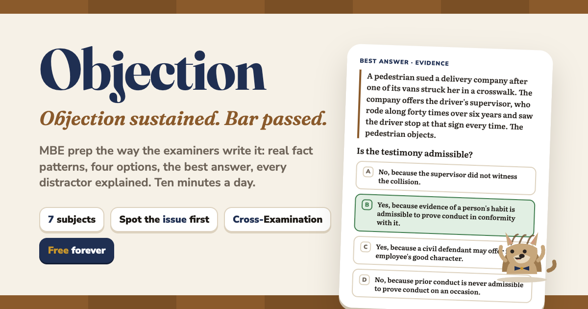

# Objection

*Objection sustained. Bar passed.*

**Live:** https://objection-bar.vercel.app (placeholder: not deployed yet; the Vercel project does not exist until the first `vercel deploy`)

**Open source** under the [MIT license](LICENSE). Free, and it will always be free. No account, no ads. The only thing we do is measure how it's used with [PostHog](https://posthog.com) (anonymous; session recordings hide anything typed) so we can make it better. Corrections to the law are very welcome: open an issue or a pull request, and say which rule, statute or case you checked.



Objection is a playful, Duolingo-style web app that prepares a US law graduate for the **Multistate Bar Examination (MBE)**, the 200-question multiple-choice half of the bar exam. It is a sibling of [Carpe](https://github.com/ionpetro/carpe) (Latin for the Greek Panhellenic exams) and [Skepsis](https://github.com/ionpetro/skepsis) (Greek roots for English speakers) and keeps their tricks: guess-first openers, apply-the-rule-to-new-facts, build-from-tiles, match pairs, yes/no sorting, spaced review, streaks with freezes and no hearts, badges, a timed speed round, a mascot with moods. Plain JavaScript, no framework, one HTML file. Run `npm test && npm run build`, then serve `app/vercel/`.

---

## Open source, and the family

Objection is free and open source (MIT). **If it helps you, please [star the repo](https://github.com/ionpetro/objection)**: a star helps other people find it. Corrections and pull requests are welcome.

Objection is one of six free, open-source learning apps built the same way (short daily lessons, spaced review, no account):

- **Skepsis**: the Greek hiding in everyday English. [Play](https://skepsis-greek.vercel.app) · [GitHub](https://github.com/ionpetro/skepsis)
- **Carpe**: Latin for Greece's national exams. [Play](https://carpe-latin.vercel.app) · [GitHub](https://github.com/ionpetro/carpe)
- **Gnothi**: Ancient Greek for Greece's national exams. [Play](https://gnothi-greek.vercel.app) · [GitHub](https://github.com/ionpetro/gnothi)
- **Objection** (this one): prep for the US bar exam (MBE). [Play](https://objection-bar.vercel.app) · [GitHub](https://github.com/ionpetro/objection)
- **Agora**: sales and negotiation, with ethics. [Play](https://agora-sales.vercel.app) · [GitHub](https://github.com/ionpetro/agora)
- **Oikos**: economics and incentives. [Play](https://oikos-azure-five.vercel.app) · [GitHub](https://github.com/ionpetro/oikos)

## What it is

An app for the phone and the laptop that makes MBE prep a game: ten minutes a sitting, with every question in the shape the examiners use (a fact pattern with no names, one call, four options, **the best answer**, and a reason every distractor is wrong). The mascot is **Amicus**, an armadillo in a bow tie (amicus curiae, "friend of the court"; the armadillo is the Texas nod). Points are **billable minutes**, the speed round is **Cross-Examination** (one wrong answer and the witness walks), the ranks run from 1L through Associate and Partner to Judge and Justice, and the mistakes notebook is called **Overruled**.

## The exam, and which exam

The MBE is 200 four-option questions in two 3-hour sessions (175 scored, 25 unscored pretest, no penalty for guessing), **25 scored questions in each of seven subjects**: Civil Procedure, Constitutional Law, Contracts, Criminal Law and Procedure, Evidence, Real Property, Torts. It is half of the Uniform Bar Examination score (MEE 30%, MPT 20%).

NCBE's **NextGen UBE** is live (first given July 2026 in ten jurisdictions; about a dozen more join in July 2027, the big states in 2028), but **the legacy MBE runs through February 2028 and is what the large majority of candidates sit in February and July 2027**, including California, New York, Texas, Florida, Illinois and Pennsylvania. Objection therefore targets the MBE. Seven of NextGen's eight concepts are the MBE subjects under the same law, so a NextGen candidate can use it too (there is a setting for that, which shows what carries over); it does not yet cover Business Associations, integrated question sets or performance tasks. Dates, adopters and sources: [`research/format.md`](research/format.md) and [`research/questions.md`](research/questions.md). Confirm your exam and date with your board.

## What it covers

14 courtrooms on the courthouse path, 2,423 cards, about 500 ten-minute sittings:

| # | Courtroom | Outline target |
|---|---|---|
| 1 | Read the call: how an MBE question works | the paper, the fourteen call families, the eleven distractor types, the clock |
| 2 | Civil Procedure I: getting into federal court | jurisdiction, removal, personal jurisdiction, service, venue, Erie |
| 3 | Civil Procedure II: running the case | pleadings, Rule 11, joinder, discovery, Rule 12 and 56 motions, jury, judgments, preclusion, appeals |
| 4 | Constitutional Law I: the structure | justiciability, Congress, the President, federalism |
| 5 | Constitutional Law II: individual rights | state action, due process, equal protection, takings, the First Amendment |
| 6 | Contracts and Sales | formation to remedies, common law and UCC Article 2 side by side |
| 7 | Criminal Law | homicide, the other crimes, inchoate offenses, parties, defenses |
| 8 | Criminal Procedure | the Fourth, Fifth and Sixth Amendments and the accused |
| 9 | Evidence (FRE) | relevancy, character, impeachment, hearsay, privileges, writings |
| 10 | Real Property I | estates, future interests, RAP, cotenancy, landlord-tenant, easements, covenants, zoning |
| 11 | Real Property II | land contracts, mortgages, foreclosure, adverse possession, deeds, recording |
| 12 | Torts | intentional torts, negligence (half the subject), strict and products liability, defamation and privacy |
| 13 | Objection Latin | the vocabulary of the exam and the numbers it tests (days, dollars, rule numbers) |
| 14 | Traps, distractors and exam day | the distractor types as a game, plus the last fourteen days |

Each subject unit opens with its **controlling-law card**, because the exam states it: FRCP and Title 28 for Civil Procedure, the federal Constitution, UCC Articles 1 and 2, the Federal Rules of Evidence as currently in effect, joint and several liability with pure comparative fault in Torts, and the common law with the majority rule in Criminal Law and Property unless the stem says otherwise. Where the law is split, the stem names the rule ("a race-notice statute", "the jurisdiction follows the Model Penal Code"), as the MBE does. Nothing is state-specific.

The subject weights (25 each) and the weights inside each subject come from NCBE's subject matter outline and nothing finer; the app shows no invented percentages.

How it plays:

- **Lesson** ("sitting"): opens with **Spot the issue** (a hypo you have not been taught; no penalty), then each rule is taught in one breath and asked at once, then the harder questions (the best answer on a full hypo, **verdict then reason**, **new facts, same rule**, best argument, the elements built from tiles, a decision tree in order, which rule number, tap the deciding facts, spot the trap in a classmate's answer, majority or minority), then a match round, and at the end whatever you missed comes back.
- **Review**: Leitner boxes (1, 3, 7, 14, 30, 60 days). In the last two weeks every card comes forward.
- **Question of the Day**: one subject per weekday, five questions, exam pace, scored like the exam.
- **Mini-MBE**: 25 questions in 45 minutes, answers hidden until the end, a per-subject breakdown, then a walk-through.
- **Cross-Examination**: 15 seconds a question, one miss and the witness walks.
- **Flash review**: 25 cards in two minutes, self-graded.
- **Overruled**: the notebook of what you missed twice, worst first, with the distractor type you keep falling for.
- **Streak**: weekends never break it, one continuance a week and another every seven days of streak (up to two). No hearts, no punishment.

The home screen counts down to the exam (presets for Feb 24, 2027, Jul 28, 2027 and Feb 23, 2028, or a custom date) and says what pace finishes every courtroom in time. The phases are **Foundations** (learn), **Discovery** (mixed practice, a Mini-MBE a week) and **Closing argument** (the last fourteen days: review only, everything due pulled forward).

## How to run

```
npm test          # validator + engine tests (node:test) over every unit, about 10 seconds
npm run validate  # the validator's readable report for all units (0 errors required; read the warnings)
npm run build     # app/dist/index.html (one file) + app/vercel/ (site: app, /outline, /about, sitemap, manifest, icons)
npm run og        # re-render app/brand/og.png from og.html (headless Chrome)
```

Locally: `npm run build && python3 -m http.server 8765 --directory app/vercel` and open `http://127.0.0.1:8765/`. Deploy: `npm run build && cd app/vercel && vercel deploy --prod` (with `POSTHOG_KEY` in `app/.env`, which stays out of git, PostHog loads; without it, no analytics). Progress stays on the device (`localStorage`). Node only, no dependencies; the fonts (Fraunces, Nunito Sans, Literata) load from Google Fonts with fallbacks.

## How the content is organised

```
app/
  src/units/u1.js … u14.js   one unit per file, plain JS objects (schema: app/CONTENT_SCHEMA.md)
  src/units/u0_example.js    the example with every kind of card (not in the build)
  src/engine.js              pure logic: dates, streaks, boxes, question builders, the daily, the mock, Cross-Examination, ranks
  src/app.js                 the UI (Amicus, the courthouse, Outline, Chambers, a renderer per question type)
  src/style.css, shell.html  courtroom palette, dark mode, phone first
  tools/validate.js          the content validator
  test/                      content.test.js (every unit passes the validator, every question plays) and engine.test.js
  build.mjs, site.mjs        the one-file build and the Vercel site
  brand/                     Amicus, the share card and its renderer
research/                    the research behind the content (see Sources)
```

The ten kinds of card: `rule` (elements in order, exceptions, the majority/minority split, the cite, examples, inline checks), `hypo` (the MBE item: stem, call, four options each with a reason and a distractor type, the deciding facts), `argue` (best argument or objection), `steps` (a decision tree in order), `pairs` (case and holding, rule number and rule, term and meaning), `sort` (yes/no or category buckets), `num` (a tested number or deadline), `case` (name, year, holding, what it replaced), `term` (law Latin, law French, terms of art), `trap` (a tempting wrong answer and why).

Every card declares its **provenance**: `status` is `book` (read in the primary text: FRE, FRCP, Title 28, UCC, the Constitution, a Restatement section, a Supreme Court opinion), `exam` (NCBE itself says so, in its outline or notes; never a copied question), `general` (standard black-letter doctrine not re-read in primary text this project) or `unsure` ("under review": never drawn by the Question of the Day or the mocks), and `src` says where it was checked. The learner sees only what makes sense ("FRE 803(6)", "Crawford v. Washington (2004)"); research file names are hidden. Cards on decisions from mid-2024 on carry `recent: true` and say so (48 of them), because NCBE items take about three years to reach the exam. The validator rejects a hypo without exactly one untrapped option, options that repeat, a `say` line over 160 characters, a rule without 2-7 elements, a hypo whose `rule` does not resolve, and more.

To add content: copy the shape from `u0_example.js`, write into the matching `uN.js`, run `npm test`. Hypos with `transfer: true` are asked cold ("New facts, same rule") and never introduced.

## Sources and the no-copying policy

NCBE owns its released questions, and the commercial outlines (Barbri, Themis, Kaplan and the rest) are copyrighted. **No NCBE question text and no commercial-outline text appears in the app or in this repository.** Every fact pattern, rule statement and explanation was written for Objection from primary law and public sources. Anything downloaded for reference (the free NCBE sample questions and subject matter outline, raw dumps) stays in `research/pastquestions-raw/` and `research/source-data/`, which are gitignored. Keep them out.

The research is in `research/` (done 2026-11-02; each file says what was read in full and what was not):

- `format.md`: the exam as given in 2027, NextGen's adoption table, dates, scores, pass rates, and what NCBE says about its own weights.
- `questions.md`: how an MBE item is built (the call families, the distractor types, timing), from NCBE's public pages and sample items, read and never copied.
- `civpro.md`, `conlaw.md`, `contracts.md`, `crim.md`, `evidence.md`, `property.md`, `torts.md`: the law of each subject against the NCBE outline, with every rule marked by where it was verified.
- `hooks.md` + `hooks.jsonl`: the stories and mnemonics behind the cards.
- `CURRICULUM.md`: the design of the 14 units and why.
- `skepsis-learning-science.md`: the literature behind the tricks (retrieval, spacing, guess-first, no punishment), inherited from Skepsis.

## What is still open

- **28 cards are `unsure`** ("under review"): they need a bar tutor. See them with `npm run validate`.
- **A second pair of eyes on the law.** The final review sampled 76 items at random across the units and found one wrong rule (the English and American rules on delivery of possession were swapped in u10; fixed) and one stale element (FRE 807's pre-2019 "not specifically covered" wording; fixed). The rest of the 2,423 cards were checked by their writers, not re-verified one by one.
- **FRE 801(d)(1)(A) changes on December 1, 2026** (the "under penalty of perjury at a proceeding" requirement goes); the Evidence unit flags it and should be re-read on that date. Decisions from 2026 (Trump v. Slaughter and others) are carried as `recent` cards and should be re-read against the opinions.
- **The share card and icon** are rendered from the mascot in `app.js`; re-run `npm run og` after changing Amicus.
- **The domain** in the site metadata is a placeholder until the first deploy.
- **NextGen mode** (select-two-of-six items, Business Associations, the Model Rules) is a later track, not v1.
- The first courtroom (reading the call) opens with cards about the exam's format; a candidate who already knows the paper can skip to any subject, since the first lesson of every courtroom is open from day one.

MIT license for the code. The content cites the rules and cases; it does not reproduce anyone's questions or outlines.

## Live site

https://objection-bar.vercel.app (Vercel project `objection-bar`, deployed from `app/vercel`)
